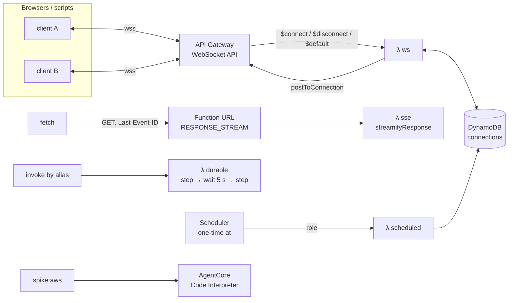

# Step 1: Skeleton + spikes

## What we built
- **A repo** with three workspaces:
  - `infra/`: the CDK app;
  - `services/`: Lambda code;
  - `scripts/`: deploy and spike tools.
- **chat-lite's own Floci** (`floci-chat`). Only one project's Floci runs at a time, and `npm run floci:up` tells you if instagram-lite's is holding port 4566.
- **A tiny core stack:** the single DynamoDB table plus `GET /health`. Every later step adds to it.
- **A throwaway spike stack** with four probes. Each one tests a foundation the whole design rests on, and we tested every probe on Floci **and** on real AWS in Sydney.

## Why spike first
The design bets on four AWS features. If one of them doesn't work, or works differently than we assumed, we want to know **before** writing hundreds of lines on top of it. A spike is a small, throwaway experiment that answers one question with evidence.

| Probe | The design question it answers | Floci | AWS (Sydney) |
|---|---|---|---|
| WebSocket API + `postToConnection` | Can one Lambda push a message to everyone in a room (chat, presence, typing)? | ✅ | ✅ (721 ms round trip from India) |
| Lambda response streaming (SSE) | Can an agent's answer stream token by token, and resume after a dropped connection? | ❌ empty body | ✅ streamed, resumes with `Last-Event-ID` |
| Lambda durable functions | Can an agent run outlive Lambda's 15-minute limit by checkpointing and pausing? | ✅ | ✅ |
| EventBridge Scheduler | Can "@morning every day 9am" trigger a run? | ✅ | ✅ (fired ~28 s late, normal) |
| AgentCore Code Interpreter | Does AWS's sandbox run code for us in Sydney, on this Free plan account? | n/a | ✅ (session in about 2 s) |

Full details are in [floci-compat.md](floci-compat.md).

**What changes in the design:** almost nothing.
- **SSE:** Floci can't stream, so locally a small HTTP server will run the *same* stream handler. AWS keeps the real Function URL.
- **Engine and sandbox:** durable functions and AgentCore both work in Sydney, so the fallback engine and fallback sandbox are **not** needed.
- **Sandbox sessions:** a session can last up to 8 hours.

## The spike stack


## The ideas, in plain words
- **WebSocket fan-out:**
  - API Gateway keeps the socket open. Your Lambda only runs when a message arrives, so nothing is "always on".
  - To send back, the Lambda calls `postToConnection(connectionId)` for each member of the room.
  - When a socket has died, AWS answers `GoneException`. We then delete that connection record; that's the standard cleanup.
- **SSE plus resume:**
  - The server writes `id: 3`, `event: tick`, `data: …` frames on one long HTTP response.
  - If the connection drops, the browser reconnects with the header `Last-Event-ID: 3`, and the server sends only what comes after.
  - That's how ChatGPT and Claude streams survive a flaky network.
- **Durable functions:**
  - Every `context.step()` result is saved as a checkpoint.
  - During `context.wait()` the function **isn't running** (no cost). Lambda then replays the code from the top, skipping finished steps by reading their saved results.
  - This is how a 2-hour agent run fits into 15-minute Lambdas, and how "wait for approval" will work later (`waitForCallback`).
- **Scheduler:** a managed cron. It assumes an IAM role to invoke our Lambda, and one-time `at(...)` schedules delete themselves.
- **AgentCore Code Interpreter:**
  - AWS runs a fresh microVM per session. We send code; it returns output.
  - No servers or VPC to manage, and you pay per second while it works.

## How big companies do it
- **WebSockets:** Slack and Discord run their own fleets of gateway servers (Elixir, Go), each holding millions of sockets. Per-message pricing like API Gateway's would be too expensive at their scale. For small and medium apps, the managed gateway is the usual choice.
- **Resumable streams:**
  - ChatGPT and Claude.ai write each generation's events to a store (Redis streams or similar) as they're produced.
  - Any server can then replay them to a reconnecting tab.
  - We'll do the same with DynamoDB run events in step 4.
- **Durable execution:**
  - Temporal (used by Netflix, Stripe, Snap) and AWS Step Functions popularised "workflows as code with checkpoints".
  - Lambda durable functions bring the same replay model into a plain Lambda.
  - OpenAI's and Anthropic's agent platforms use similar engines so long agent runs survive deploys and crashes.
- **Sandboxes:**
  - ChatGPT's code interpreter, Claude's code execution, E2B and Modal all run untrusted code in Firecracker-style microVMs: fast to boot, strongly isolated, thrown away after use.
  - AgentCore is AWS's managed version.
- **Spikes:** most teams do a short "tracer bullet" or proof of concept on the riskiest assumptions before committing to an architecture. Reporting it as a table, like `floci-compat.md`, makes the decision reviewable.

## Interview angle
- "How would you push messages to 10k connected clients serverlessly?"
  - Use a WebSocket API with a connections table and `postToConnection`.
  - Fan out in batches.
  - Clean up `GoneException` connections.
  - Watch the limits: 2 h connection life, 10 min idle timeout, 29 s integration timeout.
- "How do you make a streaming response resumable?" Give events ids, persist them, and let the client send `Last-Event-ID`.
- "How do you run a workflow longer than your function timeout?" Use durable execution with checkpoints and replay, or Step Functions, or a queue plus a state table.

## Poke it
```powershell
npm run floci:up                # chat-lite's Floci (stop instagram-lite's first: npm --prefix ..\instagram-lite run floci:down)
npm run deploy:local            # core stack; prints a curl for /health
npm test                        # unit + template tests
```

The probe stack and its `npm run spike` / `npm run spike:aws` commands were removed once the app itself covered all four features; git history has them.
