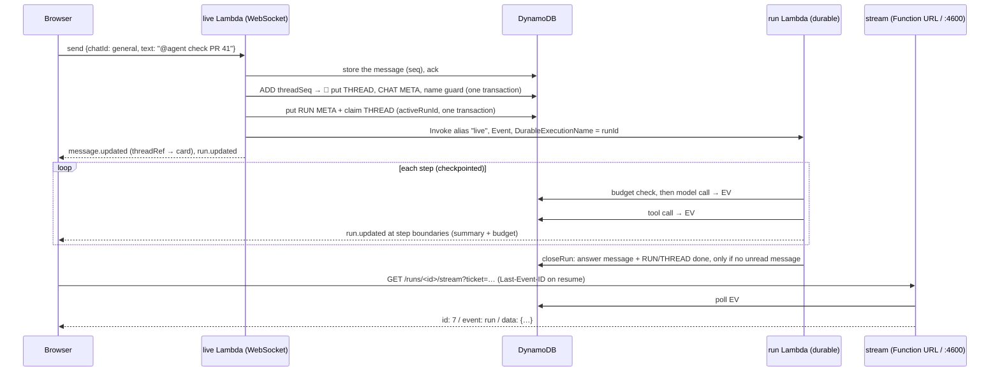

# Step 4: Agent threads (with a fake model)

## What we built
- **`@agent` in any chat starts a thread.** The message stays in the chat, and one card grows under it. The card follows the run in place (running, step count, time, then ✓ and the answer's first line), so a run never floods the chat with messages.
- **Threads are numbered and named.** Each room counts `#1`, `#2`… atomically. The first run suggests a name (`check-pr-41`), anyone can rename it, and names are unique per room (shared with chat names). `#12` or `#pr-review` in a message links to the thread; a *leading* tag delivers the message into it.
- **A run is a durable agent loop.** Model call, tool call, model call… each one a checkpointed step of a Lambda durable execution, capped at 200 steps and 2 hours. Everything the run does is appended to an event log.
- **Live progress over resumable SSE.** The thread view streams the run's events: step rows with a shimmering name and a ticking clock, then the answer fading in word by word. Drop the connection and it resumes from the last event it saw, with no word lost or repeated.
- **Steer and Stop.** A message sent while the agent works is read between steps and changes what it does next. Any member, not only the starter, can stop a run; the partial answer is kept.
- **A room budget.** $3 a month by default, set by the owner ($0–$20), reset on the 1st at 00:00 UTC. It's checked before every model call, and it's the only progress bar in the app.
- **Archiving.** A thread idle for 7 days leaves the sidebar but stays searchable and in Ctrl K; a message reopens it. Nothing is deleted.
- **The fake model** sits behind the same gateway a real one will use, so the whole loop is testable for free and deterministically.
- **`npm run smoke`** gained 18 agent-thread checks (two browsers, one of them a member who didn't start the run).

## How to try it
```powershell
npm run floci:up; npm run deploy:local       # threads, run, stream Lambdas on Floci
npm run dev                                  # the web app on :3000 AND the run stream server on :4600
npm run smoke                                # end-to-end, needs npm run dev running
npm -w services run test:int                 # repo, run-loop, stream and socket tests against Floci
```
`npm run dev` now starts two servers: Next.js, and a small Node server on `http://localhost:4600` that serves the run streams (Floci's Function URLs don't stream a body; see the Floci notes). `npm run stream:local` starts the stream server alone.

In a room, type `@agent check PR 41` in #general, or press Ctrl K and type `@agent …`. The fake model reads **directives** from the thread's first message:

| Directive | Effect |
|---|---|
| `tools:N` | N `fake.lookup` tool calls before answering (0–5, default 2) |
| `words:N` | an answer of N words (1–400, default 48) |
| `slow` | 150 ms per word and 1.5 s per tool call, so there's time to steer or stop |
| `fail` | the model throws, so the run ends "failed" after its retries |

Each steer adds one more tool call. Answers start `Fake answer for "<the first six words>".` and the suggested name is the first three words. In a dev build `window.__runStream.drop()` cuts the open run stream, to watch it resume.

## How a run flows


## The patterns
**Durable execution: checkpoint, replay, and determinism outside steps.** The run loop is ordinary async code wrapped in `withDurableExecution`. Every call to `ctx.step(name, fn)` runs `fn` once and checkpoints its result. If the Lambda dies, times out (15 min) or a step fails and is retried, the service invokes the function again from the top, and every step that already finished returns its stored result instead of running. So the code between steps must be **deterministic**: given the same step results, it must take the same path and name the same steps. That's why each step returns the loop's state (cursor, steps, cost) and the loop rebuilds itself from those values rather than from `Date.now()` or a fresh read. Step names are stable (`model-2`, `tool-2-call-3`, `close-2`), and each step retries 3 times in all. The execution as a whole is allowed 7 days: the run's own 2-hour cap counts only working time, and a write may wait up to a day for an approval, which costs nothing while paused. So the cap always ends a run cleanly long before the platform does. A step's side effects are **at least once**, so each step makes its own writes safe to repeat. A retried tool step reuses its `step.started` and never runs a tool whose result is logged. A model call is recorded in one transaction: its `usage` event, the `ADD` to the month's spend, and a `RUN#<id> / CALL#model-<n>` marker holding the step's result, conditioned on the marker being new. A retried model step looks for the marker first and returns what it holds, so a call is never charged or made twice. A retry whose earlier attempt streamed text but died before that transaction writes `text.reset {turn}` and answers again; the stored answer, the model's context and the browser's reducer all drop the text that turn wrote before the reset.

**A single-writer event log with sequence numbers.** Each run has an append-only log at `RUN#<id> / EV#<seq, 10-digit pad>`: `run.started`, `step.started`, `text` (tagged with its model turn), `text.reset`, `usage`, `step.finished`, `steer`, `run.finished`. The loop is the only writer, so the seq needs no counter item: the writer reads the newest `EV#` once, then each put is `attribute_not_exists(sk)` and chained on the one before. Everything else is derived from the log. The stream sends it, the client's reducer rebuilds the view from it, and the stored answer is exactly the run's `text` events joined, less any a `text.reset` voided. So what a viewer watched and what's saved can't disagree. The log is never deleted, so any old run can be replayed by opening its "N steps" toggle.

**Resumable SSE.** The browser reads the stream with `fetch` (not `EventSource`, so it can add headers and handle status codes). Each frame is `id: <seq>\nevent: run\ndata: <json>\n\n`. On a drop the client reconnects with `Last-Event-ID: <last seq it applied>`, and the server sends only `seq > Last-Event-ID`. The client's reducer also ignores `seq ≤ lastSeq`, so a replayed frame can't double a word. Two belts, one pair of trousers: the smoke cuts a stream mid-answer and checks the screen ends on exactly the stored text. A Lambda can't run past 15 minutes, so the stream ends itself at **14 minutes** without `run.finished`, and the client simply resumes; that's how a 2-hour run gets watched through one 15-minute function. The stream **polls** DynamoDB every 250 ms (a consistent query of `EV# > cursor`) instead of being pushed to. It's simple and correct, and costs about 4 reads a second per open viewer of a live run; at scale you'd push instead (DynamoDB Streams → a fan-out). A keepalive comment every 15 s keeps proxies from closing a quiet stream, and membership is re-checked every 30 s, so a removed member's open stream ends.

**The signal channel vs the data channel.** Two paths carry a run to the browser, and they carry different things. The room's WebSocket carries small **signals** to everyone in the room: `run.updated` at step boundaries (the thread summary, the budget and the last seq), `thread.updated`, `budget.updated` when the owner changes the cap, and the answer's `message.new`. That's all the sidebar, the card and the header capsule need. The SSE stream carries the **data**, the full event log, only to someone who opened the thread. Words never go over the WebSocket, so a room with ten people and one live run sends ten small frames per step, not ten copies of every word. Auth differs too: SSE uses a one-time ticket in the URL (60 s, consumed by a conditional delete), like the socket's ticket, with a fresh one per reconnect.

**The inbox as a cursor, and the atomic close.** Steering needs an inbox, but there are no inbox items. A thread is a chat with its own seqs, and the run stores `seenSeq`: the last thread message it has read. Unread = thread messages with `seq > seenSeq`. Before each model call the loop reads them as `steer` events and moves the cursor, but only over seqs whose message is there: two sends can store their messages out of order, so the cursor stops at a gap and waits a second for it to fill. A gap that never fills (a send that died after taking its number) is stepped over with a warning. The hard part is the end: a message can land after the last turn read the thread but before the run closes. So `closeRun` is **one transaction** that posts the answer message, marks RUN and THREAD done, and clears `activeRunId`, conditioned on the thread chat's `lastSeq` still equalling `seenSeq`. If someone sneaked a message in, the condition fails, `closeRun` returns `"unread"`, and the loop takes another turn instead. A message is never answered by nobody.

**Cooperative cancellation.** Stop doesn't kill anything. Any member's Stop sets `stopRequestedBy` on the RUN item, conditioned on `status = running`. The loop checks that flag at every step boundary and every second while the model streams (through an `AbortController` the fake model honours, as a real SDK would), then closes the run as `stopped` with "Stopped by <name>." and the text written so far. Killing the execution mid-step would lose the partial answer and could leave a half-written step; asking the code to stop at a safe point loses nothing. A run past its `deadAt` is dead: 135 minutes after its claim (the 2-hour cap plus a margin), moved on by each approval it waits on. Its thread shows it as failed and can archive, Stop closes it, and the next message replaces it: the claim marks the dead run failed in the same transaction. Every write a run makes to its thread is conditioned on `activeRunId` still being that run, so a replaced run can't overwrite the one that took its place, and no thread stays wedged.

**Pre-call budget checks with bounded overshoot.** Before every model call the loop reads the room's `USAGE#<YYYY-MM>` item and its cap. At or over the cap, the run ends `capped` with the budget text and **no** model call happens. After a call, its cost is `ADD`ed to the month item. The check and the spend aren't one transaction (the cost is only known after the call), so several runs at once can each pass the check and overshoot together, by at most the calls already in flight. That bound is the point: you can't stop money already being spent, but you can make sure nothing new starts. **Months are UTC buckets**, so an IST user at 03:00 on Dec 1 is already in December, and the reset needs no job: the next month's item simply doesn't exist yet. **Money is integer micro-dollars** (`costMicros`), never floats: $3 is 3,000,000, and adding a million tiny costs stays exact.

**Atomic counters.** `ADD threadSeq 1` on the room's META, with `ReturnValues: UPDATED_NEW`, hands out thread numbers: one write, no read, no lock, and two creates at the same moment get different numbers. The smoke creates 5 at once and checks they're distinct and gapless. The counter moves before the transaction that writes the thread, so numbers are gapless only while creates succeed; a failed create leaves a hole, which is fine for a label. The same `ADD` makes the usage totals and the `rev` that every thread write bumps (clients keep the copy with the highest `rev`, so a late frame can't undo a newer one).

**Name guard items.** DynamoDB can only enforce uniqueness on a key, so a name gets its own item: `ROOM#<room> / CHATNAME#<name>`, put with `attribute_not_exists`. Chats already used it, and threads share it, so a thread can't take a chat's name. A rename is one transaction: delete the old guard (only if it's ours), put the new one, and update the thread (only if its name is still the old one). Of two renames at once, only one wins, and the loser gets a 409 "#name is taken.". Numbered names (`thread-12`) are reserved for numbered threads, so a chat can't squat on a future thread's provisional name.

**Archive computed on read.** There's no archive flag and no sweeper job. A thread's `archived` is `now − lastActivityAt > 7 days`, worked out whenever the room view is read (and again in the browser, so a thread that goes idle while the page is open hides too). Reopening is just activity: a message bumps `lastActivityAt`, and the thread is back. Nothing to schedule, nothing to fail, nothing to migrate if the rule changes. The cost: listing only archived threads means reading the room's threads, which is cheap at this size.

**A fake model behind a gateway.** The run loop never imports a model SDK. It calls `gateway().stream(request)`, which yields `text`, `tool_call` and `usage` chunks, and `MODEL_GATEWAY=fake` picks a model that reads directives from the prompt. The fake prices tokens like a real one ($3 in / $15 out per million, tokens = ⌈chars/4⌉), so budgets, usage events and the cost bar are all exercised. Step 5 adds real adapters behind the same interface; the loop, the log, the stream and the UI don't change.

## Rulings
These were judgement calls during the build. Each line says what we chose and what it costs if the choice turns out wrong.

**Limits and timings**
| Ruling | Cost if wrong |
|---|---|
| Runs cap at 200 steps and 2 hours of working time; the durable execution timeout is 7 days (approval waits are paused time), the function timeout 15 min | A long agent job needs a raised cap |
| A step is one tool call; model calls are checkpointed but not counted | A model looping without tools is bounded only by time and budget |
| Step and time limits end a run `failed` with a specific reason; `capped` is budget-only | The card says "failed" for a limit hit |
| Each durable step tries 3 times in all, about a second apart | A flaky dependency fails a run after 3 tries |
| Text is flushed to the log every 250 ms; the stop flag is read every 1 s while streaming and at every step | Up to a second of extra words after Stop |
| SSE polls every 250 ms, keepalive every 15 s, ends at 14 min, re-checks membership every 30 s | ~4 reads/s per viewer of a live run |
| Stream tickets live 60 s and are single use | A very slow network needs a second ticket (the client asks per reconnect) |
| Model context is the last 50 thread messages | Long threads forget their start |
| Names: 1–32 chars of `[a-z0-9-]` with a letter; provisional `thread-<N>`; a taken suggestion tries `-2`…`-9`, then keeps the provisional name | An unlucky thread stays `thread-N` until renamed |
| Card summary: the answer's first line, ≤ 80 characters | None |
| Money is integer micro-dollars; caps are $0–$20, rounded to cents | A cap over $20 needs a code change, on purpose |

**Design calls**
| Ruling | Cost if wrong |
|---|---|
| A thread is a chat (`kind: "thread"`), reusing send, history, search and seqs | If threads need very different message rules, `kind` checks spread |
| The steering inbox is a cursor over thread messages, closed by one conditioned transaction; there are no inbox items | Steers that members shouldn't see would need their own items |
| The loop is the only writer of run events (the seq resumes from the newest stored event) | A second writer (approvals) needs an atomic counter on RUN META |
| SSE auth is a one-time ticket in the URL, read with `fetch`, with CORS `*` | Behind CloudFront with cookies, the ticket is redundant but harmless |
| The stream polls DynamoDB instead of being pushed | At scale, switch to DynamoDB Streams → fan-out |
| `run.updated` goes out at step boundaries and carries the thread summary and the budget, so nothing refetches | A bigger frame than a bare "new events" ping, still far under 128 KB |
| `run.finished` is appended after the close, never before, because a close can return "unread" and the run goes on | For a few ms the RUN reads done before `run.finished` is stored |
| The RUN META put and the thread claim are one transaction, so a steer writes no orphan run | None |
| The naming call is metered like any other model call | A tools:2 run shows 4 usage events, not 3 |
| The stored answer is all of the run's `text` events joined, with a blank line between turns | None |
| A message whose put lands over a second after taking its seq is stepped over (stored, unanswered), since waiting could wedge the thread | A rare unanswered message |
| A removed member's stream answers 404 at connect, and a dead run with nothing left answers 410; both stop the client instead of looping reconnects | None |
| The local stream server listens on 127.0.0.1 only | None |
| The send acks once stored; the thread and run work run after the ack in the same invocation | A failed hand-off leaves a message without its card (logged) |
| A message counts once towards the rate limit however it's routed, and server copies don't count mentions | None |
| Archive is derived from `lastActivityAt` on read; no sweeper, no flag | Listing only archived threads reads the room's threads |
| Only a leading `#tag` (or Reply on a card) delivers into a thread; mid-text tags only link | None |
| `#name` is stored as `#N`, and the UI renders the current name | `#43` meaning a PR renders as a link when thread 43 exists |
| The people message posts first, then the card attaches via `message.updated` | The card appears ~100 ms after the message (it grows in) |
| Naming runs in the run's first durable step, through the gateway and budget-checked | The name reads `thread-N` for the first second |
| The usernames `agent` and `everyone` are reserved at sign-up | A user already named `agent` would need renaming |
| Forced closes (stop, cap, limits, fail) leave late steers unanswered | The user sends again to start a new run |
| The streaming answer is plain fading words, swapped for markdown once stored | Markdown answers may restyle slightly at the swap |
| A finished step clears the thread's current step, so the capsule reads "thinking" between steps | None |
| No percentage or progress bar for agent work; only money gets a bar | None |
| The capsule's border for stopped, failed and capped is dark, so a stopped run isn't louder than a done one | None |

**Process**
| Ruling | Cost if wrong |
|---|---|
| Pure rules first in parallel worktrees, then the backend and web chains in parallel, then the smoke | Merge glue commits |
| Lean reviews from mid-step: small UI tasks had no per-task review; the smoke and the step's final review cover them | Issues surface later, in one batch |
| Int tests per task touch only that task's files; the full Floci suite and the smoke run once per step | A cross-file regression shows only at the end |

## Floci notes
- **Function URLs don't stream a body** (Floci 2.4.0: status and headers, then `content-length: 0`), so locally the SSE stream is a Node server on `:4600` that calls the same `streamRun` as the stream Lambda. `deploy:local` points the threads Lambda's `STREAM_URL` there.
- **Durable functions work,** including a Lambda starting one (`Invoke` the alias with `InvocationType: "Event"` and `DurableExecutionName`) and step retries replaying and resuming as on AWS.
- **The store's write cost grows with data.** Floci rewrites its whole DynamoDB file on every write, so writes went from ~200 ms to ~350 ms as items piled up, and the full int suite starts timing out. The 60-send history test is the first to go. Resetting the volume fixes it.
- **One Floci, several worktrees.** Every worktree deploys the same `cl-local-core` stack, so the stack is whatever was deployed last. Deploy right before int or smoke runs.
- **Not checkable locally** (on the AWS runbook): a Function URL hang-up closing the Lambda stream, and the 401/404 status prelude reaching the browser.

## Known limits
- Each viewer of a live run polls DynamoDB 4 times a second.
- A model call that dies mid-stream is paid for but never recorded (its usage only arrives at the end), and its retry is a second call.

## How big companies do it
- **Resumable streams (ChatGPT, Claude):** both stream answers as server-sent events of typed deltas, as here. The Anthropic Messages API sends `message_start`, `content_block_delta`… `message_stop`; a dropped stream there is retried as a new request, not resumed. OpenAI's Responses API in background mode is closer to this build: the response keeps running server-side, every event carries a `sequence_number`, and a client that drops can reconnect and stream again from `starting_after` a number, which is `Last-Event-ID` by another name. The consumer apps do the same thing at the product level: close the tab mid-answer and the answer is still there when you come back, because the generation never depended on your connection.
- **Temporal and Step Functions vs Lambda durable functions:** Temporal is the reference design for durable execution. A workflow's every step is recorded in an event history, a worker that dies is replaced, and the code replays against the history. Its rule ("workflow code must be deterministic; do I/O in activities") is the same rule as here ("do I/O in steps"). Step Functions takes the other road: the workflow is a state machine in JSON (ASL), not code, so there's nothing to replay, and Standard workflows run up to a year and bill per state transition. Lambda durable functions put Temporal's model inside Lambda: plain code, checkpointed steps, replay, without running a Temporal cluster. For an agent loop whose shape depends on what the model says next, code beats a state diagram.
- **Log-structured agent events:** OpenAI's Assistants API modelled exactly this: a **thread** of messages, a **run** with a status (`queued`, `in_progress`, `cancelling`, `cancelled`, `failed`, `completed`, `expired`), **run steps** for each tool call, and a cancel endpoint that is cooperative too. LangGraph checkpoints the agent's state after every node, keyed by thread, so a run can resume, be inspected or be forked. Underneath, it's event sourcing: store what happened, derive what things look like.
- **Metering and spend guards:** Stripe's usage-based billing takes **meter events** (an amount, a customer, a timestamp) and aggregates them per billing period, as our `ADD` per call into `USAGE#<month>` does. OpenAI puts each organisation in a usage tier with a monthly spend limit, and lets projects set budgets and alerts; requests over the limit are refused. Those are the same two layers as here: a running total per period, and a check before new spend.
- **Slack's thread model:** in Slack a thread is replies hanging off a parent message (`thread_ts` points at the parent's `ts`), and the channel shows a compact "N replies" line under the parent instead of every reply. That's our card: one line in the channel, kept up to date, with the conversation one click away. Slack's "also send to #channel" is the reverse of our leading `#tag`, which sends a channel message into a thread.

## Interview angle
- "How do you make a long-running agent survive a crash?" Durable execution: checkpoint each model and tool call, replay finished steps from their results, keep the code between steps deterministic, and make side effects idempotent or tolerate at-least-once.
- "The user's connection drops mid-answer. What happens?" The run doesn't depend on the connection. The client reconnects with `Last-Event-ID`, the server sends only later events, and the client dedupes by seq.
- "A user sends a message just as the agent finishes. Is it lost?" No: the close is a transaction conditioned on the inbox cursor, so it fails, and the loop answers the message.
- "How do you stop runaway spend?" Check the budget before every call, record actual cost after, bound the overshoot by calls in flight, use integer money and UTC month buckets.
- "How do you cancel an agent safely?" Cooperatively: set a flag, check it at safe points, keep the partial work.
