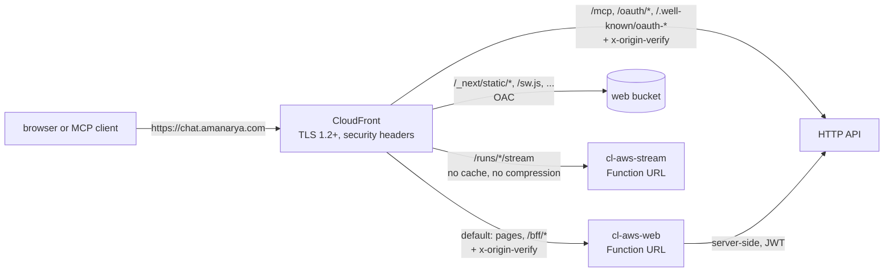

# Step 11: Ready for real AWS

**Nothing in this step was deployed.** It is the infrastructure, the checks and the runbook for putting chat-lite on `https://chat.amanarya.com`. Every proof here is a `cdk synth` without credentials plus the infra unit tests. The deploy itself is [docs/runbook-aws.md](../runbook-aws.md), which Aman runs by hand, one checked step at a time.

**Steps 9 and 10 merged in afterwards.** Their schedules, push worker, push routes, voice Lambda, two push secrets and `GEMINI_API_KEY` got their alarms, dashboard lines and log retention from the sweep below with no edit to ops. The merge did need edits elsewhere: the runbook's rows and counts, four more cdk-nag exceptions, and two narrower invoke grants. A credential-less synth after it: 20 named functions (plus CDK's two helpers), 23 alarms, 5 secrets, 15 outputs, 411 resources, and cdk-nag at 105 compliant, 130 suppressed, 0 open.

**411 of CloudFormation's 500 resources per stack.** Each HTTP route costs three (route, integration, Lambda permission), so another feature or two of routes fits, but not many. Past that, the web site (CloudFront, its bucket and its deployments) would move to its own stack.

## What we built
All of it is aws-only: the local (Floci) template has no CloudFront, alarm, SNS, dashboard or new log group, so `deploy:local` is unchanged.
- **Prod settings.** The domain is a constant in `infra/lib/config.ts`. The two account-specific values, the alert email and the us-east-1 certificate ARN, sit in the gitignored `infra/cdk.context.json`, which the CDK CLI loads by itself (`infra/cdk.context.example.json` shows the shape). An aws synth with a value missing or malformed fails and names that file; a local synth never reads it.
- **The site** (`infra/lib/web.ts`): the Next.js server built by OpenNext on a Lambda Function URL (`cl-aws-web`), its static files in an S3 bucket, and one CloudFront distribution on `chat.amanarya.com` in front of them, the run stream and the API's MCP and OAuth paths. The web gate refuses any request that skipped CloudFront; it is the step's only change to web app code.
- **Ops** (`infra/lib/ops.ts`): an SNS topic `cl-aws-ops` that mails the alert address, an errors alarm for every Lambda we named, a 5xx alarm per HTTP API, an execution-errors alarm per WebSocket API, one account-wide throttles alarm, and the `cl-aws-ops` dashboard.
- **Hardening:** the table (with point-in-time recovery), the user pool, the files bucket and the secrets survive `cdk destroy`; every Lambda and the API's access log keep one month of logs; the HTTP API and the socket's `live` stage are throttled to 50 requests a second, bursts of 100.
- **An AwsSolutions gate** (`infra/lib/compliance.ts`): cdk-nag runs on every aws synth, and a finding without a written reason fails it.
- **The runbook** (`docs/runbook-aws.md`) and its test (`infra/lib/runbook.test.ts`).
- **GitHub sign-in before connecting repos** (app code, in [07](07-tools-approvals.md)): a room admin connects only the installations and repos their own GitHub account reaches. It is the runbook's gate before inviting friends.

## How to try it
Offline only. Nothing below can reach an account: the shell has no credentials, so neither the CLI nor the SDK can sign a call. In Git Bash:
```bash
npm -w web run build:open-next        # the stack ships web/.open-next; a synth without it fails with "Build the web app first"
cd infra
env -u AWS_PROFILE -u AWS_ACCESS_KEY_ID -u AWS_SECRET_ACCESS_KEY -u AWS_SESSION_TOKEN -u AWS_ENDPOINT_URL \
  AWS_CONFIG_FILE=/dev/null AWS_SHARED_CREDENTIALS_FILE=/dev/null AWS_EC2_METADATA_DISABLED=true CDK_DISABLE_CLI_TELEMETRY=true \
  npx cdk synth cl-aws-core -c stage=aws -c alertEmail=ops@example.com \
  -c certificateArn=arn:aws:acm:us-east-1:123456789012:certificate/00000000-0000-0000-0000-000000000000 --strict --no-notices -q
cd ..
npm -w infra test                     # template tests, including the runbook's
```
Then read:
- `infra/cdk.out/cl-aws-core.template.json`: search for `AWS::CloudFront::Distribution` (its `CacheBehaviors`), `AWS::CloudWatch::Alarm` and `DeletionPolicy`;
- `infra/cdk.out/AwsSolutions--cl-aws-core-NagReport.csv`: every rule, compliant or suppressed with its reason.

Drop `-c alertEmail=…` to see the synth fail and name `infra/cdk.context.json`.

## How a request reaches the right origin


## The patterns
**One CloudFront in front of four origins, picked by path.**
- **The behaviours.** The default goes to the web Lambda (pages and the BFF). `/_next/static/*` and one behaviour per top-level file or folder of `public/` go to the bucket: OpenNext's server bundle leaves `public/` out, so `/sw.js` and `/pcm-worklet.js` must come from S3. `/runs/*/stream` goes to the stream Lambda. `/mcp`, `/oauth/*` and `/.well-known/oauth-*` go to the HTTP API, because MCP clients discover the OAuth server on the site's own domain.
- **Dynamic paths are never cached,** and they forward every viewer header, query string and cookie except `Host` (`AllViewerExceptHostHeader`).
- **Why Host can't pass.** A Function URL and API Gateway both route by `Host`: sent `chat.amanarya.com`, they don't know which function or API is meant. CloudFront sends the origin's own host instead, and a viewer-request CloudFront Function copies the site's host into `x-forwarded-host`, so Next.js still sees `chat.amanarya.com` as its host for redirects and the BFF's same-origin check.
- **A secret header, not OAC, in front of the web Lambda.** Origin access control can sign CloudFront's requests to a Function URL, but for a POST or PUT the *viewer* must send `x-amz-content-sha256`, the body's SHA-256, and our BFF's writes come straight from the browser's `fetch`. So the Function URL stays public, CloudFront adds `x-origin-verify` to every request, and the web gate answers 403 `Forbidden.` to anything without it, in constant time. With no secret set (`next dev`), the check is off. The secret is the random UUID at the end of the stack's ID: stable for the stack's life, never in git, and not in Secrets Manager because it opens nothing outside this stack. Anyone with read access to the account can see it (the stack's ID is in the tag CloudFormation puts on each resource it creates), and rotating it means recreating the stack. Secrets Manager would make it rotatable but not hidden: CloudFront shows its origins' custom headers to anyone who can read the distribution's config. If it leaked, someone could call the web Lambda directly and pick the IP the OAuth rate limits count; that is the whole blast radius. The bucket does use OAC, since CloudFront only reads it.
- **SSE through CloudFront.** The spec draws the run stream through CloudFront, so the stream is same-origin and `STREAM_URL` is the site. The ticket in the query string is the stream's auth, so that origin needs no secret header. Its behaviour:
  - is never cached and never compressed (gzip would buffer events until a block fills);
  - allows only GET and HEAD;
  - has a 60 s origin read timeout. CloudFront's default is 30 s between bytes, and the stream sends a keepalive comment every 15 s;
  - forwards `?ticket=` and the `last-event-id` header, so a reload resumes.

**The viewer's IP behind CloudFront, trusted only from CloudFront.** The OAuth endpoints rate-limit by IP. Through CloudFront, API Gateway's `sourceIp` is an edge server, shared by everyone near it. The viewer's address arrives in `CloudFront-Viewer-Address` (`ip:port`; the port is cut after the last colon, so IPv6 works). But the API also answers on its own execute-api host, where anyone can send that header. So `viewerIp` (`services/src/oauth/viewer-ip.ts`) believes it only when the request also carries the origin secret, compared with `timingSafeEqual`; otherwise it uses `sourceIp`. The rule in general: a forwarded-for header is only as trustworthy as the proof that your proxy wrote it.

**Assets ship with the stack, not a script.** Two `BucketDeployment`s copy the build into the bucket on every deploy:
- `_next/static/*`, whose names carry a content hash, with `max-age=31536000, immutable`;
- everything else with `max-age=0, must-revalidate`. CachingOptimized honours that (its minimum TTL is 1 s), so no CloudFront invalidation is needed.

Nothing is pruned, so a page still open from the last deploy can load its old bundles. `outputObjectKeys: false` matters: a CloudFormation custom resource's reply is capped at 4 KB, and listing every build file would overflow it and fail the deploy. The bucket itself is deleted with the stack (`autoDeleteObjects`), since everything in it is rebuilt.

**Why the certificate lives in us-east-1.** CloudFront is a global service whose configuration lives in us-east-1, so it reads ACM certificates only from there, whatever region the rest of the stack is in. This account's policy blocks CloudFormation outside Sydney, so the certificate can't be a resource in a us-east-1 stack. It is requested with the CLI, validated by a DNS record at Spaceship, and its ARN goes in `infra/cdk.context.json`. The config refuses an ARN outside us-east-1 at synth time, which is much better than a CloudFront error twenty minutes into a deploy.

**Alarms from a sweep of the construct tree.** `addOps` runs as the constructor's last line and calls `stack.node.findAll()`: every `lambda.Function` we named, every `HttpApi`, `WebSocketApi`, `Table` and `Distribution`. A Lambda that a later step adds gets its alarm, its dashboard lines and its log retention with no edit to ops.
- **Named means ours.** CDK's own helpers (the asset deployment's handler, the auto-delete provider) have generated names. The test is the `CfnFunction`'s `functionName` being a plain string: `fn.functionName` is always a token, because CDK wraps it for cross-stack references, so checking that would drop every function.
- **Why not an Aspect.** An aspect visits each construct, which suits checks (cdk-nag is one), but this needs every alarm in one place for the dashboard, and aspects that add constructs depend on the order they run in. One function at the end is simpler and gives the same coverage.
- **Why CloudFront has no alarm.** CloudFront publishes its metrics in us-east-1, with the dimensions `DistributionId` and `Region=Global`, and an alarm can only watch metrics in its own region. The dashboard does graph them, hand-built: CDK's `Distribution.metric*()` leave out `Region=Global` and the region, and their graphs would be empty on a Sydney dashboard.
- **A topic policy replaces SNS's default one.** `enforceSSL` adds an `AWS::SNS::TopicPolicy` with a TLS-only deny, and that policy *replaces* the default access policy, the one that let same-account services publish. A CloudWatch alarm publishes as the `cloudwatch.amazonaws.com` service, which no IAM policy can grant, so without an explicit allow every alarm changes state and its mail fails ("not authorized to perform SNS:Publish" in the alarm's history). The topic allows that service back in, only for `arn:…:cloudwatch:<region>:<account>:alarm:*` and with `aws:SourceAccount` set: the confused-deputy guard, so no other account's alarm can use our topic.
- **Table throttles** use `ReadThrottleEvents` and `WriteThrottleEvents` (by table name only). `ThrottledRequests` needs an `Operation` dimension, and CDK's helper for it is deprecated.

**Choosing alarm metrics by symptom.** Each alarm watches something a user would notice, and its description says what they feel ("messages don't send and live updates stop") and links to the runbook's `## When an alarm fires`:
- `<function>-errors`: 3 or more in 5 minutes. A function maps to a feature, so the alarm's name says what broke;
- `cl-aws-api-5xx`: 5 or more server errors in 5 minutes;
- `cl-aws-ws-execution-errors`: the socket API couldn't call its Lambda 5 or more times. Not `IntegrationError`, which also counts the Lambda's 4xx answers: every `$connect` refused for a bad ticket is one, and the socket's URL is in the page's JavaScript, so anyone could have set it off. The Lambda's own failures have `cl-aws-live-errors`;
- `cl-aws-lambda-throttles`: account-wide, because one function using up the concurrency quota throttles all the others (and instagram-lite shares the quota).

Every alarm has one evaluation period, treats missing data as fine (a quiet function is a healthy one), and mails both on alarm and on OK, so the mail thread shows when it ended. The cost: an OK action also fires when a new alarm leaves its starting state (`INSUFFICIENT_DATA`), so each deploy that adds a function sends one OK mail per new alarm. Avoiding that would mean routing state changes through EventBridge to drop those, which isn't worth it for a few mails. There are no CPU- or duration-style alarms: those are causes, and the dashboard shows them once a symptom fires. Thresholds are guesses until a week of real traffic.

**cdk-nag: fix or write the reason down.** `AwsSolutionsChecks` is an Aspect added in `bin/app.ts` for the aws stage only. An error fails `cdk synth` and `cdk deploy`, so a new finding needs a fix or a suppression with its reason in `compliance.ts`.
- **The fixes:** the chat Lambda's `grantPut` on `rooms/*` became plain `s3:PutObject`. Signing a presigned POST needs nothing else, and `grantPut` also gave `Abort*`, object tagging, legal hold and retention. And the push worker and the schedule fire function are invoked through a grant on their own ARN, where CDK's `grantInvoke` adds `<arn>:*` (every version and alias) that nothing calls. Both apply to both stages.
- **Suppressed, each with its reason:**

  | Finding | Where | Why it stays |
  |---|---|---|
  | COG1, COG2, COG8 | user pool | 8-character minimum without composition rules (NIST SP 800-63B); no MFA for a few invited friends, every account has a verified email; threat protection needs the Plus tier |
  | SMG4 | model and tool keys | providers issue them, so they're rotated by hand there |
  | SMG4 | token key | rotating it would make every sealed MCP sign-in unreadable |
  | SMG4 | both push secrets | a new VAPID pair orphans every browser's subscription, so it's changed by hand, with a resubscribe |
  | S1 | files and web buckets | files go through URLs a logged function signs; the web bucket is read only by CloudFront. Server access logs would need another bucket |
  | CFR1, CFR2, CFR3 | distribution | no country to block; WAF costs at least $5 a month, and the throttles and Cognito's limits cover a friends-only site; access logs would need a log bucket |
  | APIG1 | socket stage | WebSocket access logs need the account-wide API Gateway role every stack shares; the live Lambda logs instead |
  | APIG4 | 12 public HTTP routes, in 4 groups | health; invite preview (the code is the credential); `/mcp` (checks its own OAuth tokens); OAuth discovery, register, authorize, token and revoke (how a client gets a token) |
  | APIG4 | every socket route | only `$connect` can take an authorizer, and it checks the one-time ticket itself |
  | IAM4 | every function's role | exactly `AWSLambdaBasicExecutionRole` (logs only), and the run function's durable execution policy |
  | IAM5 | five exact wildcards | the table's `index/*`; each function's own prefix of the files bucket (`generated/` and `speech/` among them); POST on the one stage's `@connections/*`; durable executions under `cl-aws-run:*`; schedules in the stack's own group |
  | IAM5 | the voice function's `Resource: *` | Transcribe streaming has no resource type, and Polly's only one is lexicons, which chat-lite doesn't use |
  | IAM5, L1 | CDK's asset-copy handler | its grants and runtime come with aws-cdk-lib |
  | L1 | every Node 22 function | the runtime they're all proven on; they move together |
- **Suppressions are narrow on purpose.** By path where a resource is meant (`addResourceSuppressionsByPath` throws if the path disappears, so a stale reason can't linger), and wildcards only through anchored `appliesTo` regexes. A test pins that a new public route, or a new `s3:*` or `Resource: *` grant, still fails the gate.
- **The `<AWS::AccountId>` gotcha.** A synth without credentials leaves the account to CloudFormation, and cdk-nag then shows ARNs with `<AWS::AccountId>` where a real synth shows 12 digits. The first credential-less synth failed on that, so each ARN regex accepts both, and the tests run both forms.
- **Why 2.x.** `cdk-nag` 3.x is a rewrite: a policy-validation plugin with per-finding acknowledgements, no `NagSuppressions` and no annotations. 2.38.2 is the last 2.x and supports aws-cdk-lib 2.275.

**Retained user data and point-in-time recovery.** On aws the table (`cl-aws-main`), the user pool, the files bucket and the five secrets are `RETAIN`; Floci still deletes everything.
- **PITR** keeps 35 days of continuous backups. A restore creates a *new* table at any second in that window, which undoes a bad write or a bad migration; it can't rewrite the live table.
- **Fixed names cut both ways.** A retained `cl-aws-main` makes the next fresh deploy fail, because the name is taken. So the runbook's teardown lists the manual deletes for a clean slate, and says to update the stack in place to keep the data.
- **Logs aren't users' data.** Every log group is `DESTROY`, for the same reason: a retained `/aws/lambda/cl-aws-run` would block the next deploy with "already exists". The stack creates each Lambda's group itself, with one-month retention, so the runbook checks that none exists before the first deploy. CDK's own helper Lambdas (the asset copy and the bucket auto-delete) are the exception: they're named `cl-aws-core` plus a generated suffix, and Lambda makes their groups itself, so the stack doesn't own them. Those groups survive `cdk destroy` and never expire, but they never collide either, so the runbook's checks leave them out and its teardown says how to delete them.
- **The user pool's retain is aws-only** (`isLocal ? DESTROY : RETAIN`), like the secrets.

**Stage throttling as connection-rate protection.** API Gateway throttles with a token bucket per stage and route: 50 requests a second, bursts of 100. On the socket's `live` stage that also covers `$connect`, so a flood of new sockets is refused at the edge before any Lambda runs (and before it uses up concurrency). `HttpApi` takes no options for the stage it creates by itself, so the throttle and the access log are set on its `CfnStage`. Account-wide limits (10,000 a second by default) sit above it, and the Lambda concurrency quota usually bites first: a new account can sit at 10, so the runbook asks for the increase before anything else.

## What only real AWS proves
Synth and unit tests show the template says the right things. They can't show AWS accepts and runs it. The runbook checks each of these after the deploy:
- **the deploy itself:** the AgentCore interpreters in Sydney, the run function's durable config, CloudFront taking several minutes, and a failed create rolling back (Floci can't roll back);
- **the edge:** the certificate, the security headers, the Function URL refusing direct calls with 403, the OAuth paths and `/mcp` reaching the API through CloudFront, and a streamed status prelude passing through it;
- **the stream through CloudFront:** events one by one, resume with `Last-Event-ID`, and the stream Lambda ending when the tab closes;
- **IAM,** which Floci doesn't enforce at all, and DynamoDB's real validation: one Logs Insights query over every `/aws/lambda/cl-aws-*` group after walking each feature;
- **behaviour Floci hides:** GSI lag, transaction conflicts, offline presence timing, S3 lifecycle expiry, AgentCore sandboxes offline and online;
- **the GitHub sign-in on real GitHub,** which no automated test reaches;
- **what Floci fakes or skips:** Transcribe and Polly (the voice live suite runs against AWS), Gemini images, delivery to real phones, and Scheduler across a DST change in the room's zone;
- **ops:** the SNS confirmation, a test alarm mailing `ALARM` then `OK`, and every graph having lines (the CloudFront dimension gotcha above shows up only as an empty graph).

## The runbook's choices
- **Aman runs every command.** No deploy, secrets or ops script calls AWS. Each step ends with a **Check** (a command and the output that means it worked) and a **Stop if**.
- **Values are named, never written:** the account ID, the alert address, the certificate ARN and the keys. The alert address is copied from instagram-lite's context file by a `node` one-liner, never typed. `runbook.test.ts` fails on a 12-digit number, an `arn:aws:`, an email address, `--all` or an instagram-lite name.
- **The test keeps the runbook honest:** every `cl-aws-*` name it uses exists in the template, every output it reads exists, every secret in the template has a row saying how to fill it, and `## When an alarm fires` (every alarm's link) exists.
- **Keys go in by CLI from a temporary file,** built by the same helpers `deploy:local` uses and deleted straight after, so a key never reaches the command line, the history or the screen. Fill them before first use: each Lambda caches a secret per container.
- **Order:** login, concurrency quota and leftover log groups first; then the certificate, the context file and a strict synth, all before anything exists in the account; then deploy, keys, alarm email, DNS, a first user, the only-AWS checks, ops and cost; friends last.
- **Decisions marked for Aman:** a single-name certificate (recommended) or a wildcard; skip the load test on AWS (recommended), since the aws stage always runs real models.

## Rulings
These were judgement calls during the build. Each line says what we chose and what it costs if the choice turns out wrong.

| Ruling | Cost if wrong |
|---|---|
| All step-11 IaC is aws-only; Floci deploys stay as they were | Floci never exercises CloudFront or alarms; the runbook checks them on AWS |
| The domain is fixed in config; the cert ARN and alert email are in the gitignored `infra/cdk.context.json`, required on aws, with no env-var fallback | Add `-c` flags; nothing else changes |
| Empty strings count as missing; the format check runs once both values are there | None found |
| Every `-c stage=aws` synth needs the context file, the spike stack's too, because `bin/app.ts` always builds `cl-aws-core` | `spike:aws` needs the file first; the runbook orders it before bootstrap |
| A new single-name cert for `chat.amanarya.com`, requested by CLI in us-east-1 | A `*.amanarya.com` wildcard also works; only the ARN changes |
| The site is in `cl-aws-core`, and assets ship with `BucketDeployment`, so there is no deploy script | Split out a web stack if deploys get slow |
| CloudFront reaches the web Lambda with a secret header, not OAC | OAC would need signed POST bodies from the browser |
| The origin secret is the stack ID's UUID, not a Secrets Manager secret | Account readers can see it and rotating it means a new stack. A leak lets someone call the web Lambda directly and pick the OAuth rate-limit IP; it opens nothing outside this stack |
| `CloudFront-Viewer-Address` counts only alongside the origin secret | Direct execute-api callers are limited by their own `sourceIp`, as before |
| SSE goes through CloudFront at `/runs/*/stream`; the ticket stays its auth | Point `STREAM_URL` back at the Function URL |
| The HTTP and WebSocket APIs keep their execute-api hosts (the BFF calls the API server-side; tickets guard the socket) | API custom domains would need a second, regional cert |
| Two `BucketDeployment`s, no prune, `outputObjectKeys: false`, no invalidation | Old bundles pile up in the bucket until a teardown |
| Web bucket `DESTROY` with `autoDeleteObjects` | Adds CDK's auto-delete helper Lambda |
| `cl-aws-web` is a plain `lambda.Function` (its code isn't in `services/src`) with its own one-month log group; 1 GB, 15 s | A slow page render hits 15 s before CloudFront's 30 s |
| Alarms come from a construct-tree sweep: every named Lambda, every API, one account-wide throttle alarm; CloudFront gets none | Tune thresholds after a week of real traffic |
| Ops names are fixed `cl-aws-*`: `addOps` only runs on aws | None |
| The ops topic allows `cloudwatch.amazonaws.com` to publish, for this account's alarms in this region only, next to the TLS-only deny | A new publisher (an EventBridge rule, say) needs its own allow |
| The socket alarm watches `ExecutionError`, not `IntegrationError`, which counts every refused connect | A Lambda failure that shows only as an integration error is caught by `cl-aws-live-errors` instead |
| Alarms keep their OK action, so a new alarm mails OK once after the deploy that adds it | A handful of OK mails per deploy that adds functions |
| No reserved concurrency on `cl-aws-web` or `cl-aws-stream`: it can't be set at the quota of 10 | A flood on a public Function URL throttles both apps until it stops or the runbook's CLI cap goes on |
| The dashboard's concurrency line is account-wide; errors, p90 duration and throttles are per function | Who used the quota is read off the per-function lines |
| One `EDGE_THROTTLE` (50/s, burst 100) shared by the HTTP and socket stages, set on the HTTP stage through `CfnStage` | Raise it for a load test |
| On aws the table (with PITR), user pool, files bucket and secrets are `RETAIN`; every log group is `DESTROY` | A clean slate needs the runbook's manual deletes |
| No WebSocket access logs: they need the account-wide API Gateway role, which instagram-lite shares | Add it once the account is prod-only |
| cdk-nag pinned to 2.38.2, a runtime dependency of infra | Moving to 3.x means rewriting `compliance.ts` |
| Three fixes (`s3:PutObject`, and invoke grants without `:*` for the push worker and the schedule fire function), every other finding suppressed with a reason, by path or exact regex | A doc-worthy reason for each new finding |
| Secrets are filled by CLI from a temp file built by the existing helpers; no AWS-calling script | A `secrets:aws` script would make it one command |
| No budget alarm: Free plan credits, plus the app's own room caps | Add an AWS Budget if the account leaves the Free plan |
| Admins connect only GitHub installations their own account reaches, and only repos it can push to (in [07](07-tools-approvals.md)); every page of both lists is read. The runbook won't invite friends before that check passes on AWS | Every Connect goes through GitHub's sign-in. `push` is the minimum: a push-only collaborator's room can have the agent merge a PR, if branch protection allows it |

## npm dependencies added
- **`cdk-nag` 2.38.2** (infra, exact pin like `aws-cdk-lib`): the AwsSolutions rules as a CDK Aspect.
- **`@opennextjs/aws` ^4.1.15** (web, dev): turns `next build` into a Lambda bundle plus CDN files. It's the version instagram-lite builds Next 16.4.5 with. Our `open-next.config.ts` is a plain request/response handler on the API Gateway v2 event shape (a Function URL's too), with no ISR cache, tag cache or revalidation queue, because every page is personal.

## Floci notes
- None of step 11's resources exist on Floci, by design: its template has no CloudFront, alarms, SNS or new log groups, and `deploy:local` is unchanged.
- CDK's `autoDeleteObjects` fails on Floci (its helper calls S3 on port 443), which was one more reason to keep the web bucket aws-only.
- Every gap the [Floci report](floci-compat.md) and the earlier learn docs list became a row in the runbook's step 9.

## Known limits
- **No WAF, no CloudFront access logs, no geo rules.** The throttles and Cognito's limits are the only edge defence.
- **The Function URLs are public, with no throttle in front of them.** Direct calls to `WebFunctionUrl` or the stream's URL are turned away (403, or 401 without a ticket), but each is still a Lambda invocation from the account's shared concurrency, which instagram-lite uses too. There is no reserved concurrency to cap them: at the new-account quota of 10 none can be set (Lambda keeps 100 unreserved), so a deploy that set it would fail until the increase lands. `cl-aws-lambda-throttles` is the signal, and the runbook's row for it caps the flooded function by CLI once the quota is raised.
- **The execute-api hosts stay public.** Direct calls skip CloudFront's headers; the JWT authorizer, tickets and `viewerIp`'s rule still apply.
- **CloudFront isn't alarmed,** only graphed. An edge outage shows as silence on the other alarms.
- **One region, one stack.** A failed deploy rolls back everything, and CloudFront makes each deploy take several minutes.
- **Cognito's default sender** allows about 50 mails a day, which caps sign-ups.
- **The thresholds are guesses** until real traffic.

## How big companies do it
- **Multi-account.** Prod lives in its own AWS account under AWS Organizations, so a mistake in dev can't touch it, with org-wide guardrails (service control policies, CloudTrail and Config everywhere) rolled out by StackSets or Control Tower. We share one account with instagram-lite and keep apart by stack and name prefix.
- **WAF and Shield.** A web ACL on CloudFront with AWS's managed rule groups and per-IP rate rules; Shield Advanced for large DDoS. Our stage throttles are the cheapest slice of that.
- **Synthetic canaries and SLO burn-rate alarms.** CloudWatch Synthetics scripts sign in and send a message every few minutes, so a broken path alarms before a user writes in. Alarms are set on how fast the error budget burns (Google's SRE multi-window burn rates), not on raw counts like our "3 in 5 minutes".
- **On-call.** Alarms page a rotation through PagerDuty or Opsgenie, with escalation and a runbook link in every page. Ours mail one address; the runbook link is the same idea.
- **Safe deploys.** Lambda aliases with CodeDeploy shift traffic 10% at a time and roll back by themselves when an alarm fires. We deploy all at once and roll back by redeploying the last good commit.
- **Policy as code in CI.** cdk-nag, cfn-guard or Checkov run on every pull request, and a finding blocks the merge, with suppressions reviewed like code. Our gate runs on every synth, the same check one step earlier.

## Interview angle
- "Your site sits behind CloudFront, but the origin has a public URL. How do you stop people skipping the CDN?" Origin access control where the origin can verify CloudFront's signature (S3 always; Lambda when the viewer can sign bodies). Otherwise a secret header CloudFront adds and the origin checks in constant time, rotated with the stack.
- "Behind a CDN, how do you rate-limit by client IP?" Use the CDN's viewer-address header, but only when you can prove the CDN wrote it (the origin secret); if the origin is reachable directly, fall back to the connection's own address.
- "How do you make sure every new Lambda gets monitoring?" Generate the alarms from the infrastructure code itself: sweep the construct tree after everything is added, so coverage is a property of the stack, not a list someone maintains. Pin it with a test that adds a function to a bare stack.
- "Which alarms do you set?" On symptoms users feel, per feature: errors, 5xx, failed integrations, throttles. Each says what's broken for users and links the runbook. Causes go on the dashboard.
- "How do you keep a `cdk destroy` from deleting customer data?" Retain the stateful resources, turn on point-in-time recovery, and know the cost: fixed names then block a fresh deploy, so a clean slate is a deliberate manual step.
- "How do you enforce security rules on IaC?" A policy-as-code gate (cdk-nag) on every synth. Fix what can be fixed; suppress the rest narrowly, by resource and exact permission, with the reason in the code next to it, so a reviewer can disagree with a sentence.
