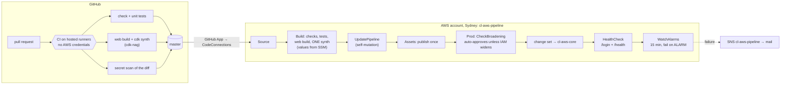

# CI/CD: checks in GitHub, delivery from inside AWS

**Nothing here was deployed.** It is the workflows, the pipeline's infrastructure, their tests and a credential-less synth. Turning it on is [runbook step 12](../runbook-aws.md#12-cicd-setup), which Aman runs by hand.

A credential-less synth of the aws app now gives two stacks:
- `cl-aws-pipeline`: 38 resources; cdk-nag 37 compliant, 65 suppressed, 0 open;
- `cl-aws-core`, inside the pipeline's prod stage: 414 resources; cdk-nag 106 compliant, 131 suppressed, 0 open.

## What we built
- **CI** (`.github/workflows/ci.yml`), on every pull request and every push to master, on GitHub's hosted runners:
  - `npm ci`, `npm run check` (knip, eslint, `tsc`), the unit tests of all four workspaces;
  - the OpenNext build and `cdk synth -c stage=aws --strict` with stand-in values for the two account settings, so the AwsSolutions checks gate every pull request;
  - the pre-push hook's secret scan (`.githooks/scan-diff`) over the lines the pull request adds.
- **The Floci run** (`.github/workflows/floci.yml`): the integration suite and the browser smoke, each on a fresh Floci on its own runner. It is started by hand for now (see "Floci in a runner" below).
- **CD** (`infra/lib/pipeline-stack.ts`): `cl-aws-pipeline`, a self-mutating CodePipeline V2 built with CDK Pipelines. It pulls master through a CodeConnections GitHub connection, runs the same checks again, synthesizes once, updates itself, publishes the assets, and deploys `cl-aws-core` behind an IAM-broadening gate, a health check and a 15-minute alarm watch.
- **The prod stage** (`infra/lib/prod-stage.ts`): a CDK `Stage` holding the core stack under its old name, `cl-aws-core`.
- **`bin/app.ts`:** local builds `cl-local-core` exactly as before, so `deploy:local` and Floci are untouched. On aws the app builds only `cl-aws-pipeline`, with `cl-aws-core` inside it.
- **cdk-nag for the pipeline** (`addPipelineComplianceChecks` in `infra/lib/compliance.ts`).
- **Tests:** `pipeline-stack.test.ts` (source, stages, gate, steps, small machines, no long-lived credentials, nag), `prod-stage.test.ts` (the stage keeps every logical ID), and `runbook.test.ts` (every `cdk` target and SSM parameter in the runbook exists).

## The whole path


## Why CI and CD are split
**The usual answer is blocked here.** Most teams deploy straight from GitHub Actions: an IAM OIDC identity provider trusts GitHub's tokens, and a role trusts only `repo:<owner>/<repo>:environment:prod`. This account is a new-experience "project" account on the free plan, and the AWS-managed service control policy denies `iam:*Provider*` on both the free and the paid plan, so the OIDC provider can't exist. The other GitHub-side option, an IAM user's access keys in GitHub secrets, is the anti-pattern an interviewer asks about first.

**So the work splits along where credentials live.**
- CI needs no AWS access at all. A `cdk synth` without credentials leaves the account as a CloudFormation token, and the cdk-nag rules already accept that form.
- CD runs inside the account, where IAM roles are the credentials. The pipeline's CodeBuild jobs assume CDK's bootstrap roles to deploy. Nothing in GitHub can deploy.
- It also suits a public repo. A fork's pull request runs CI, which has nothing to steal, and only master ever reaches the pipeline, pulled by the pipeline itself.

| Check | CI (pull request) | Pipeline (master) | Why |
|---|---|---|---|
| `npm run check`, all unit tests | yes | yes | CI is the gate; the pipeline re-runs them on the exact commit it ships |
| web build + `cdk synth --strict` + cdk-nag | yes, with stand-in values | yes, with the real values from SSM | policy as code on every change |
| secret scan | yes, on the diff | no | a hook can be skipped with `--no-verify`; CI can't. On master there is no diff to scan |
| Floci integration + smoke | by hand | no | needs a full emulator; see below |
| `cdk diff --security-only` | no (needs the deployed stack) | yes, in the broadening gate | |

## How a push becomes a deploy
1. A push to master reaches GitHub. The **AWS Connector for GitHub** app, installed on this one repo, tells **CodeConnections**, which holds the account's side of that trust. The app's tokens are short-lived and scoped to the repo.
2. The pipeline's source action (`CodeStarSourceConnection`, branch `master`) starts a new execution with that commit. V2 pipelines run in SUPERSEDED mode: a newer commit overtakes an older one still waiting.
3. The connection's ARN holds the account ID, so it isn't in git. The pipeline stack reads it from Parameter Store at deploy time, through a CloudFormation parameter of type `AWS::SSM::Parameter::Value<String>`, so neither a laptop nor the pipeline needs it to synthesize.

## Build once, promote the same bytes
- The **Build** step runs `cdk synth` once. Its output, the cloud assembly, holds every template and every content-hashed asset: the Lambda zips and the OpenNext bundle.
- **Assets** publishes them to CDK's bootstrap bucket once, and every later stage deploys those exact bytes. A staging stage would get the same artifact, never a rebuild. One asset action (`publishAssetsInParallel: false`) instead of about 25, because each action bills at least a minute.
- **Self-mutation.** `UpdatePipeline` deploys `cl-aws-pipeline` from the same assembly before anything else. A change to the pipeline rides in the same pull request as the app change: the pipeline updates itself, then restarts on the new definition, so it can't drift from the code it deploys.

## Moving the core stack into a stage without replacing anything
CloudFormation matches resources by **logical ID**. Change one and CloudFormation creates a new resource and deletes the old: a new table, a new user pool, new secrets, and with fixed names and `RETAIN`, a failed deploy.
- **Logical IDs come from the construct path inside the stack** (`Main/Resource` becomes `Main…`), not from the stage above it. So `new CoreStack(stage, "cl-aws-core")` keeps every one.
- **The stack name doesn't survive by itself.** A stack in a stage is named `<stage>-<id>` (`Prod-cl-aws-core`), which would be a second, empty stack beside the live one. `stackName: "cl-aws-core"` pins it.
- **The proof** (`prod-stage.test.ts`) synthesizes the core stack both ways, top-level as it was deployed and inside the stage, and asserts the same logical IDs and types. Both apps bundle the Lambdas for real, because a function version's logical ID hashes its code's asset: with bundling skipped, the placeholder asset depends on the path and the test would compare noise.
- **What does change** is anything CDK names from the full construct path, stage included. The test pins exactly these: CloudFront's origin IDs (`Names.uniqueId`) and the two `aws-cdk:cr-owned:*` tag keys `BucketDeployment` puts on the site bucket (`node.addr`). Both are in-place updates, and the pipeline's first run makes them once.
- **One definition.** On aws the app has no top-level `cl-aws-core` any more; a break-glass laptop deploy names it by path (`cl-aws-pipeline/Prod/cl-aws-core`). Two copies would differ in those origin IDs and flip CloudFront back and forth on every alternate deploy.
- cdk-nag's suppressions are built from `stack.node.path`, so they find their resources inside the stage too; a test checks the staged stack has no open finding.

## The permission-broadening gate
`ConfirmPermissionsBroadening` sits before the prod deploy.
- A CodeBuild job runs `cdk diff --security-only --fail` against what is deployed.
- **No new IAM statements or security-group rules:** it invokes a small Lambda that approves the manual-approval action at once.
- **They broaden:** it mails the `cl-aws-pipeline` topic a link to the diff, and the approval waits for a person.

That is the laptop's `y/n` on IAM changes, automated without `--require-approval never`. A manual approval on every deploy would slow every release and add nothing for a solo developer. Approval actions are free.

## After the deploy: health, alarms, and what actually rolls back
- **HealthCheck** gets `SiteUrl` and `ApiUrl` from the stack's outputs (`envFromCfnOutputs`) and `curl -f`s `/login` and `/health`, with retries for CloudFront and DNS settling.
- **WatchAlarms** polls `describe-alarms --alarm-name-prefix cl-aws- --state-value ALARM` every minute for 15 minutes (three of the alarms' five-minute periods) and fails the run on any alarm. Its role can only `cloudwatch:DescribeAlarms`.
- **A failed run** mails the pipeline topic through a CodeStar notification rule.

| What went wrong | What happens by itself | What a person does |
|---|---|---|
| The CloudFormation deploy fails | CloudFormation rolls the change set back to the last template; the run stops | Read the first failure, fix, push |
| The deploy succeeds, then an alarm fires | `WatchAlarms` fails the run and mails. **Nothing is undone** | `git revert` on master, which the pipeline deploys; or, faster, pause the pipeline and laptop-deploy the last good commit |
| The pipeline breaks itself | The run stops at `UpdatePipeline` | Laptop `cdk deploy cl-aws-pipeline` from a good commit |
| Bad data | Nothing; data is never rolled back | Point-in-time recovery; expand/contract changes so old code reads new data |

Automatic rollback on alarms is the next step: a V2 stage condition (`onSuccess`, an alarm rule, result `ROLLBACK`) redeploys the last successful execution's artifacts, the exact bytes that were live before. CDK Pipelines doesn't expose conditions yet, so it needs the `CfnPipeline` escape hatch.

## Secrets
- **None in GitHub.** CI has no AWS access, and the pipeline's GitHub access is the app's short-lived token.
- **Parameter Store for account values that aren't secret:** `/chat-lite/alert-email` and `/chat-lite/certificate-arn` reach the synth as CodeBuild environment variables of type `PARAMETER_STORE`, then `-c` flags; `loadConfig` is unchanged. A laptop still reads `infra/cdk.context.json`. The synth's role may read only those two parameters (a test pins it). Standard parameters are free.
- **App keys stay in Secrets Manager,** filled by hand through the runbook. CloudFormation only owns each secret's shell, so the pipeline never reads or needs a key.
- **The secret scan runs three times:** the pre-push hook, CI on the diff, and (if turned on) GitHub's push protection.

## Cost
| | Per deploy | About 10 deploys a month |
|---|---|---|
| GitHub Actions | $0 (public repo, hosted runners) | $0 |
| CodeBuild, `general1.small` ($0.005 a minute, 100 free a month): synth ~12, self-update ~2, assets ~3, broadening check ~2, health ~1, alarm watch 15 | ~35 minutes | ~$1.25 |
| CodePipeline V2 ($0.002 per action-minute, 100 free a month) | ~45 action-minutes | ~$0.70 |
| SNS mails, notification rule, artifact bucket, approvals | cents | cents |

About **$1.50 to $3.50 a month** at a few deploys a week. The alarm watch is the biggest line, 15 CodeBuild minutes a deploy. No KMS key (`crossAccountKeys: false`, one account), which would be $1 a month.

## Floci in a runner
The integration suite and the smoke need a full Floci, and Floci runs each Lambda as a sibling container through `/var/run/docker.sock`. GitHub's Ubuntu runners have Docker, so that part works. The catch is the host:
- The local stage was built on Docker Desktop, where `host.docker.internal` inside a container reaches the host's loopback. The sandbox and MCP test servers bind `127.0.0.1` only, on purpose, and Floci's Lambdas reach them by that name.
- On Docker Engine (Linux), the name is the bridge gateway (`172.17.0.1`), where nothing listens.
- The workflow routes the gateway to loopback (`route_localnet` plus one `iptables` DNAT rule), which is what Docker Desktop does. That is unproven on GitHub's runners, so the workflow runs on demand. After its first green run it can become a required check.

## What phase 2 and later add
- **Staging as a second account.** A second "project" in AWS Settings is a real account boundary, the closest thing to multi-account without AWS Organizations. Bootstrap it trusting this one, turn on `crossAccountKeys` (one KMS key, about $1 a month), run every integration fake there, and point the smoke at it before prod.
- **Canaries.** Integrate request-path Lambdas through a `live` alias, then a CodeDeploy `LambdaDeploymentGroup` (`CANARY_10PERCENT_5MINUTES`) shifts traffic and moves the alias back by itself when an alarm fires. At friends' traffic a canary may see no requests, so it needs synthetic traffic during the bake. The durable run function waits, since in-flight executions are pinned to old versions.
- **Split the stack before 500 resources** (414 now): stateful data, stateless app, web, moved without replacement by `cdk refactor`.
- **Automatic rollback on alarms** with a stage condition; weekly drift detection; DORA metrics from pipeline events; Dependabot and a master ruleset with required checks.

## Jenkins, for comparison
No Jenkins server here; this is how the same pipeline would look on one.

```groovy
pipeline {
  agent { label 'linux-node22' }
  triggers { githubPush() }
  options { disableConcurrentBuilds(abortPrevious: true) }
  environment {
    ALERT_EMAIL = credentials('chat-lite-alert-email')     // or read from SSM on an AWS agent
    CERTIFICATE_ARN = credentials('chat-lite-certificate-arn')
  }
  stages {
    stage('Checks') { steps { sh 'npm ci && npm run check && npm test' } }
    stage('Synth') {
      steps {
        sh 'npm -w web run build:open-next'
        dir('infra') { sh 'npx cdk synth -c stage=aws -c alertEmail="$ALERT_EMAIL" -c certificateArn="$CERTIFICATE_ARN" --strict -q' }
        stash name: 'assembly', includes: 'infra/cdk.out/**'       // build once
      }
    }
    stage('Prod') {
      when { branch 'master' }
      stages {
        stage('Broadening') {
          steps {
            unstash 'assembly'
            script {
              def widens = sh(script: 'cd infra && npx cdk diff -a cdk.out --security-only --fail "cl-aws-pipeline/Prod/*"', returnStatus: true) != 0
              if (widens) input message: 'IAM or security groups widen. Deploy?'
            }
          }
        }
        stage('Deploy') { steps { sh 'cd infra && npx cdk deploy -a cdk.out cl-aws-pipeline/Prod/cl-aws-core --require-approval never' } }
        stage('Health') { steps { sh 'curl -fsS --retry 5 https://chat.amanarya.com/login -o /dev/null' } }
        stage('Watch alarms') { steps { sh './scripts/watch-alarms.sh 900' } }
      }
    }
  }
  post { failure { mail to: "$ALERT_EMAIL", subject: "chat-lite deploy failed", body: "${env.BUILD_URL}" } }
}
```
- **Same stages, different owner.** Declarative `stages` map one to one onto the pipeline's actions; `stash` is the cloud assembly; `input` is the manual approval; `when { branch 'master' }` is the trigger rule. Self-mutation has no direct equivalent: the Jenkinsfile is read from the repo on every run, and the jobs themselves come from Job DSL or Configuration as Code.
- **The trade-offs:**
  - **You run the server.** The controller and its agents need patching, scaling, backups and monitoring, and the controller is a high-value target: it holds every credential and runs every job. CodePipeline and GitHub's runners have no server for you to own.
  - **Plugins** cover anything, and are also where it breaks: version conflicts on upgrade and a supply-chain surface of hundreds of community plugins.
  - **Idle cost.** A controller runs around the clock (a small EC2 instance is $15–30 a month before agents), where CodePipeline and CodeBuild bill per minute used.
  - **Credentials.** Jenkins keeps its own credentials store. On AWS the good pattern is agents with an EC2 instance profile, so no long-lived keys, but anyone who can change a Jenkinsfile on a trusted branch can use that role. CodePipeline scopes a role to each action; GitHub Actions gets short-lived OIDC tokens where the account allows it.
- **When companies still choose Jenkins:** a large existing estate of jobs and plugins; on-premises, air-gapped or regulated builds that can't use a SaaS runner; many targets beyond one cloud; unusual build farms (GPUs, macOS for iOS, big C++ builds); or very high volume on hardware they already own.

## Rulings
These were judgement calls during the build. Each line says what we chose and what it costs if the choice turns out wrong.

| Ruling | Cost if wrong |
|---|---|
| On aws the app builds only `cl-aws-pipeline`; `cl-aws-core` lives inside its prod stage and a laptop deploys it by path | Runbook commands name the path; nothing else |
| The stage pins `stackName: "cl-aws-core"`; a bundled synth test pins every logical ID and allows only the origin-ID and owner-tag changes | The test adds about two minutes to the infra suite |
| The connection ARN comes from SSM at deploy time (a CloudFormation SSM parameter); the alert email and certificate ARN from SSM at synth time | A third parameter to create by hand |
| One `cl-aws-pipeline` SNS topic, mailed to the alert address, for broadening approvals and failed runs, separate from the app's ops topic | One more confirmation mail |
| The alarm watch is a CodeBuild step polling `describe-alarms` for 15 minutes, failing the run; no automatic rollback yet | About $0.08 a deploy, and a person reverts |
| `DescribeAlarms` on every alarm, suppressed with its reason | It reads alarm states only |
| `STANDARD_8_0` image with Node 22 and small compute everywhere | If `next build` runs out of memory, switch the synth to medium |
| CDK CLI not pinned in the pipeline (CDK's advice: the latest CLI reads older assemblies) | A breaking CLI release would stop self-mutation; pin `cliVersion` then |
| Pipeline cdk-nag findings are suppressed by exact wildcard (artifact bucket, own log and report groups, bootstrap roles), plus CB4 and S1 with reasons | A new kind of grant still fails, and a test pins that |
| The Floci workflow runs on demand until one green run proves the loopback routing on GitHub's runners | Integration and smoke stay local until then |

## How big companies do it
- **A deployment account and one account per environment,** under AWS Organizations: the pipeline lives in a tooling account and deploys into dev, staging and prod through cross-account roles. Here, one account, with staging as a second project later.
- **Waves.** Prod is many regions or cells, deployed one wave at a time with bake times between them, so a bad change hits one cell first (the Amazon Builders' Library's "automating safe, hands-off deployments").
- **Automatic rollback everywhere:** CodeDeploy alarms on each function, stage conditions on each wave, and synthetic canaries that keep traffic flowing through quiet hours.
- **Merge queues and required checks** on a protected trunk, with Dependabot or Renovate keeping dependencies moving.

## Interview angle
- "How do you deploy without long-lived keys?" OIDC where the account allows it, a role trusted only for one repo's prod environment. Where it doesn't, the pipeline runs inside the cloud account on IAM roles and pulls the code through a scoped GitHub App, so CI holds nothing at all.
- "What does self-mutation buy you?" The pipeline's definition ships in the same pull request as the app, deployed by the pipeline itself, so it can't drift from what it deploys.
- "How do you stop a deploy from widening permissions unnoticed?" A security-only diff before prod that auto-approves when nothing widens and stops for a person when it does.
- "How do you roll back?" Be exact about what is automatic: CloudFormation reverts a failed change set; alarms after a successful deploy need either a stage condition that redeploys the last good artifact or a revert rolled forward; data rolls forward only.
- "How do you refactor infrastructure without replacing it?" Know where logical IDs come from (the construct path inside the stack), pin anything the refactor would rename, and prove it with a test that synthesizes both versions.
- "Jenkins or a managed service?" Managed when the team is small and lives in one cloud; Jenkins when the estate, the hardware or the rules already demand one.
